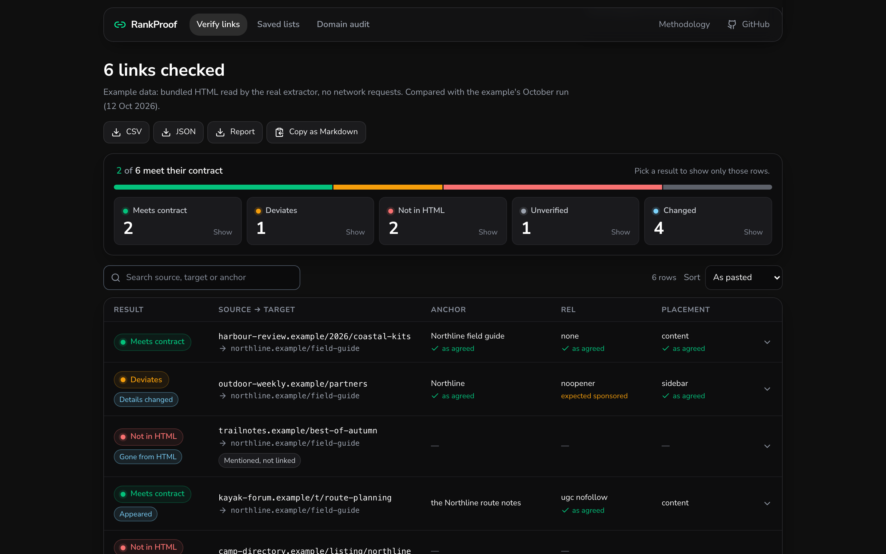

# RankProof

**Verifiable web relationships. Open source.**

RankProof checks whether a page really links to yours — the exact URL, the agreed anchor, rel and placement — keeps a receipt of what it read, and tells you what changed since the last check. It never mistakes "could not check" for "missing", and it says exactly what its evidence does and does not prove ([evidence](docs/evidence.md)).

Built for link builders, digital PR teams and agencies who need to know what is actually live on publishers' pages, and for tools and agents that need trustworthy link observations instead of guesses. An experimental domain audit (discovery from open sources, search positions, site structure) is included as a secondary tool.


[](https://github.com/CometWeb-io/rankproof/actions/workflows/ci.yml)
[](LICENSE)
[](https://rankproof.cometweb.io/)

**Node.js 22+ · Web UI, CLI and HTTP API · Package version 1.1.0**

`main` may contain changes recorded under **Unreleased** in [CHANGELOG](CHANGELOG.md); check API capabilities rather than assuming every checkout or package has the same endpoints.

## Run locally

```bash
git clone https://github.com/CometWeb-io/rankproof.git
cd rankproof
npm ci
npm run dev
```

Open **http://localhost:8080**. Local history uses embedded PGLite when `DATABASE_URL` is unset. The development server binds to localhost.



## Verify the backlinks you already track

```bash
npm run cli -- verify links.csv --format html --out report.html
```

`links.csv` holds one pair per line — `source_url,target_url[,expected_anchor,expected_rel,expected_placement]`. Each link ends as **meets contract**, **deviates** (linked, but anchor or rel differ), **not in HTML** or **unverified** (an error, never counted as a lost link). Add `--previous run.json` to see what changed since an earlier run and `--capture-dir evidence/` to keep the fetched HTML for an offline `rankproof replay`. Add `--history monitor/ --webhook <url>` and run it from cron to monitor links over time; `rankproof history monitor/` shows each link's record. The same workflow is the home page of the web app, where **Saved lists** keep up to 200 links per list on the server and compare every run with the previous one.

Links added by JavaScript or hidden with CSS? Add `--render` (optional `playwright` + Chromium) to check pages in a headless browser as well.

How accurate is it? `npm run benchmark` scores the extractor on a labelled corpus of hard cases and lists the known limitations — see [benchmark](docs/benchmark.md).

### Over HTTP

The HTTP API accepts exact public source/target URL pairs (up to 50 per request) and reports `confirmed`, `not_found` or `error` with observation details. **`not_found` is scoped to fetched HTML; `error` is not evidence of a missing backlink.** JavaScript-inserted links are not rendered.

Start with the [known-backlink verification quickstart](docs/backlink-verification-quickstart.md). For API response semantics and safe hosting, see [HTTP API](docs/api.md).

**Local API security:** keep it on loopback. Without `RANKPROOF_API_TOKEN` the API does not authenticate callers; a publicly exposed deployment also requires the documented proxy, rate limits and DNS-pinning controls. See [production operations](docs/production-ops.md) before deploying beyond localhost.

## Try the CLI

```bash
npm run cli -- help
npm run cli -- scan example.com --market us --format json --out report.json
```

Replace `example.com` with a public site you are authorized to audit. Scans make network requests; engine blocks and missing data remain visible in the results.


_Animated excerpt of actual local command output. [Static version](docs/media/cli.png)._

## What can I inspect?

| Area              | Output                                                            |
| ----------------- | ----------------------------------------------------------------- |
| Known backlinks   | Contract check (URL, anchor, rel), change report, HTML evidence   |
| Search visibility | Positions, keyword ideas, SERP overlap and scan history           |
| Backlinks         | Discovered links checked against source-page HTML                 |
| Site structure    | Internal links, redirects, canonical issues and orphan candidates |
| Comparison        | Link gaps and changes between scans                               |
| Reporting         | JSON, CSV and a standalone HTML report                            |

Bing, DuckDuckGo and Mojeek are enabled by default; Brave is optional. **Google organic results require a separately configured provider.** Search Console supplies data for a property you control. See [providers](docs/providers.md) and [Search Console setup](docs/search-console.md).

## Know what the numbers mean

- Discovery is incomplete: a missing backlink is not proof that it does not exist.
- Traffic estimates and difficulty scores are models, not measured visits or third-party SEO metrics.
- CAPTCHA or blocked requests are measurement gaps, not zero rankings.
- Risk scores and disavow exports require human review.

Read the [metric definitions](docs/metrics.md) before comparing scores.

## Go further

| Task                                  | Guide                                                               |
| ------------------------------------- | ------------------------------------------------------------------- |
| CLI commands and flags                | [CLI reference](docs/cli.md)                                        |
| Verify known backlinks                | [Step-by-step quickstart](docs/backlink-verification-quickstart.md) |
| Know what a result proves             | [Evidence](docs/evidence.md)                                        |
| Integrate (Python / TypeScript)       | [API contract and clients](contract/README.md)                      |
| Let an AI agent verify links          | [MCP server](docs/mcp.md)                                           |
| Check links in CI                     | [GitHub Action example](docs/examples/link-check.yml)               |
| Run in a container                    | [Dockerfile](Dockerfile)                                            |
| See which problems were fixed         | [Status of fixes](docs/roadmap.md)                                  |
| Measure verification accuracy         | [Benchmark](docs/benchmark.md)                                      |
| Integrate over HTTP                   | [OpenAPI spec](docs/openapi.yaml)                                   |
| Run the HTTP service                  | [API reference](docs/api.md)                                        |
| Configure engines and integrations    | [.env.example](.env.example)                                        |
| Understand discovery and verification | [Architecture](docs/architecture.md)                                |
| Deploy beyond localhost               | [Production operations](docs/production-ops.md)                     |
| Contribute or report a vulnerability  | [Contributing](CONTRIBUTING.md) · [Security](SECURITY.md)           |

```bash
npm run check
npm run build
```

[MIT license](LICENSE). Bundled fonts use the [SIL Open Font License](public/fonts/OFL.txt). Maintained at [CometWeb](https://cometweb.io).
