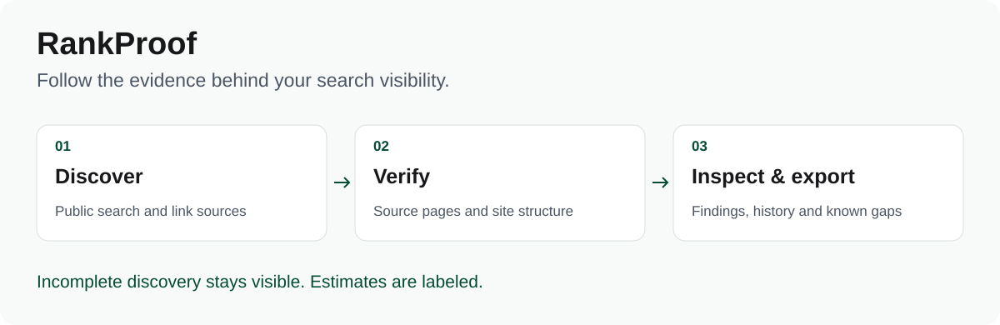
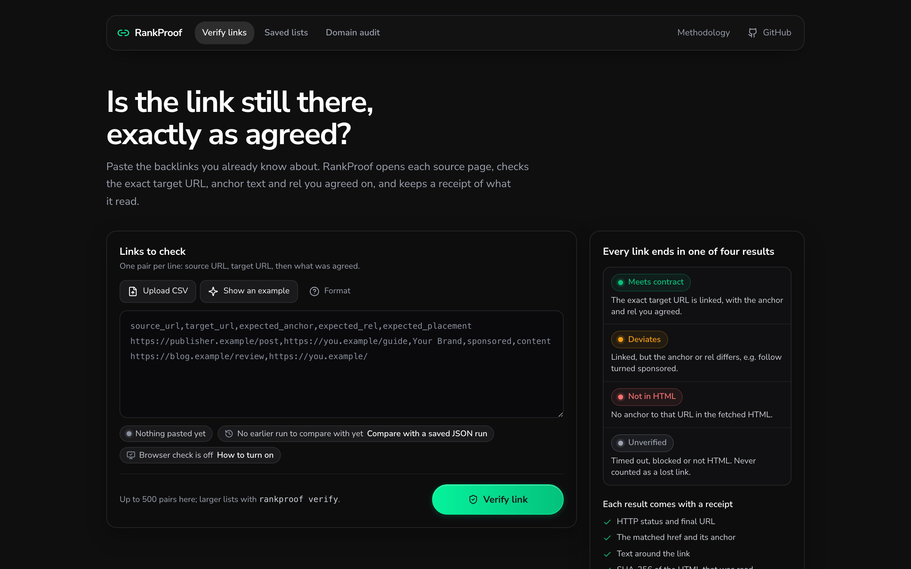
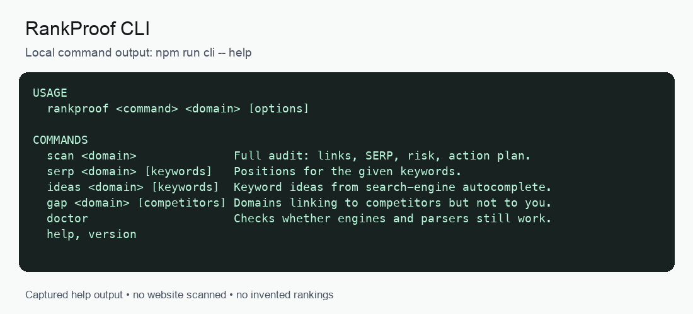

# RankProof

**Verify backlinks you already know about, with inspectable evidence.** RankProof checks source-page HTML and tells you when a link was confirmed, not found in the inspected HTML, or could not be verified. It also offers local search-visibility and site-structure audits.



[](https://github.com/CometWeb-io/rankproof/actions/workflows/ci.yml)
[](LICENSE)

**Node.js 22+ · Web UI, CLI and HTTP API · Package version 8.2.0**

`main` may contain changes recorded under **Unreleased** in [CHANGELOG](CHANGELOG.md); check API capabilities rather than assuming every checkout or package has the same endpoints.

## Run locally

```bash
git clone https://github.com/CometWeb-io/rankproof.git
cd rankproof
npm ci
npm run dev
```

Open **http://localhost:8080**. Local history uses embedded PGLite when `DATABASE_URL` is unset. The development server binds to localhost.



## Verify a backlink you already track

The HTTP API accepts exact public source/target URL pairs (up to 50 per request) and reports `confirmed`, `not_found` or `error` with observation details. **`not_found` is scoped to fetched HTML; `error` is not evidence of a missing backlink.** JavaScript-inserted links are not rendered.

Start with the [known-backlink verification quickstart](docs/backlink-verification-quickstart.md). For API response semantics and safe hosting, see [HTTP API](docs/api.md). Available since 8.2.0.

**Local API security:** keep it on loopback. Without `RANKPROOF_API_TOKEN` the API does not authenticate callers; a publicly exposed deployment also requires the documented proxy, rate limits and DNS-pinning controls. See [production operations](docs/production-ops.md) before deploying beyond localhost.

## Try the CLI

```bash
npm run cli -- help
npm run cli -- scan example.com --market us --format json --out report.json
```

Replace `example.com` with a public site you are authorized to audit. Scans make network requests; engine blocks and missing data remain visible in the results.



_Animated excerpt of actual local command output. [Static version](docs/media/cli.png)._

## What can I inspect?

| Area              | Output                                                            |
| ----------------- | ----------------------------------------------------------------- |
| Search visibility | Positions, keyword ideas, SERP overlap and scan history           |
| Backlinks         | Discovered links checked against source-page HTML                 |
| Site structure    | Internal links, redirects, canonical issues and orphan candidates |
| Comparison        | Link gaps and changes between scans                               |
| Reporting         | JSON, CSV and a standalone HTML report                            |

Bing, DuckDuckGo and Mojeek are enabled by default; Brave is optional. **Google organic results require a separately configured provider.** Search Console supplies data for a property you control. See [providers](docs/providers.md) and [Search Console setup](docs/search-console.md).

## Know what the numbers mean

- Discovery is incomplete: a missing backlink is not proof that it does not exist.
- Traffic estimates and difficulty scores are models, not measured visits or third-party SEO metrics.
- CAPTCHA or blocked requests are measurement gaps, not zero rankings.
- Risk scores and disavow exports require human review.

Read the [metric definitions](docs/metrics.md) before comparing scores.

## Go further

| Task                                  | Guide                                                               |
| ------------------------------------- | ------------------------------------------------------------------- |
| CLI commands and flags                | [CLI reference](docs/cli.md)                                        |
| Verify known backlinks                | [Step-by-step quickstart](docs/backlink-verification-quickstart.md) |
| Run the HTTP service                  | [API reference](docs/api.md)                                        |
| Configure engines and integrations    | [.env.example](.env.example)                                        |
| Understand discovery and verification | [Architecture](docs/architecture.md)                                |
| Deploy beyond localhost               | [Production operations](docs/production-ops.md)                     |
| Contribute or report a vulnerability  | [Contributing](CONTRIBUTING.md) · [Security](SECURITY.md)           |

```bash
npm run check
npm run build
```

[MIT license](LICENSE). Bundled fonts use the [SIL Open Font License](public/fonts/OFL.txt). Maintained at [CometWeb](https://cometweb.io).
